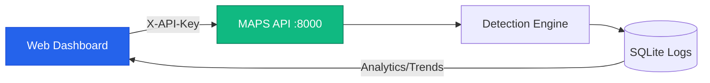

# MAPS Shield - Malicious AI Prompt Scanner

[](https://www.python.org/downloads/)
[](https://fastapi.tiangolo.com/)
[](https://streamlit.io/)

**MAPS Shield** is an enterprise-grade, multi-layer security engine designed to detect and block malicious prompts before they reach your Large Language Models (LLMs). It protects AI systems from prompt injection, jailbreak attacks, weaponized queries, and system prompt leakage using an advanced 8-layer architecture.

---

## 🏗️ Architecture

MAPS employs a defense-in-depth strategy, routing user prompts through 8 distinct security layers.

```mermaid
graph TD
    User([User Prompt]) --> API[FastAPI Gateway]
    
    subgraph MAPS Detection Engine
        API --> L1[Layer 1: Keyword Detection]
        API --> L2[Layer 2: Regex Patterns]
        API --> L3[Layer 3: N-Gram Leakage]
        API --> L4[Layer 4: Semantic Similarity]
        API --> L5[Layer 5: ML Classifier]
        API --> L6[Layer 6: Rule Engine]
        
        L1 & L2 & L3 & L4 & L5 & L6 --> L7[Layer 7: Risk Scoring]
        
        L7 --> |Score 5-60 <br> Ambiguity Band| L8[Layer 8: LLM Classifier]
        L7 --> |Score > 60 <br> High Risk| Decision
        
        L8 --> Decision{Final Decision Engine}
    end

    Decision -->|ALLOW| Safe[Forward to LLM]
    Decision -->|WARN| Log[Log & Proceed Caution]
    Decision -->|BLOCK| Block[Block Request]
    
    style User fill:#0f172a,stroke:#3b82f6,color:#fff
    style MAPS Detection Engine fill:#1e293b,stroke:#334155
    style L8 fill:#2563eb,stroke:#1d4ed8,color:#fff
    style Decision fill:#0f172a,stroke:#f59e0b,color:#fff
    style Safe fill:#10b981,color:#fff
    style Block fill:#ef4444,color:#fff
```



### 🛡️ The 8 Security Layers

| Layer | Type | Description | Weight |
|-------|------|-------------|--------|
| **1** | **Keyword Detection** | Fuzzy matching against attack keywords (Jailbreaks, WMDs, Illegal Acts). | 40 pts |
| **2** | **Regex Patterns** | Complex pattern matching for known attacks and system prompt extractions. | 20 pts |
| **3** | **N-Gram Leakage** | Template-based structural detection to catch obfuscated bypasses. | 15 pts |
| **4** | **Semantic Similarity** | `Sentence-Transformers` embedding distance to known malicious prompt clusters. | 25 pts |
| **5** | **ML Classifier** | Pre-trained Scikit-Learn Logistic Regression model on adversarial datasets. | 20 pts |
| **6** | **Rule Engine** | Consensus engine that triggers when multiple weak layers detect anomalies. | 15 pts |
| **7** | **Risk Scoring** | Aggregates all scores. Prompts scoring `> 60` are generally considered Malicious. | - |
| **8** | **LLM Classifier** | Dynamic safety net powered by **Groq/OpenAI** that evaluates ambiguous prompts contextually. | 30 pts |

---

## 🚀 Quick Start

### 1. Installation

Clone the repository, pull the Git LFS model binaries, and install dependencies:

```bash
git clone https://github.com/DeeptanshNagar/MaliciousPromptScanner.git
cd MaliciousPromptScanner

# Required: Pull pre-trained model binaries tracked by Git LFS
git lfs install
git lfs pull

pip install -r requirements.txt
```

> **Important (Git LFS):** The ML model (`models/ml_model.pkl`, `models/ml_vectorizer.pkl`) and semantic embeddings (`models/semantic_embeddings.npy`) are tracked by Git LFS. If you download the repo as a ZIP or clone without Git LFS, these files will only be 130-byte pointer text files. Skipping this step disables the ML and semantic layers.
>
> **No-LFS Alternative:** If Git LFS is not installed on your machine, you can download the transformer models and train the ML classifier locally:
> ```bash
> python scripts/download_models.py
> python train_models.py
> ```

### 2. Environment Setup

Copy the example environment file:

```bash
cp .env.example .env
```

Generate a secure random API key for MAPS authentication:

```bash
# Using OpenSSL:
openssl rand -hex 32

# Or using Python:
python -c "import secrets; print(secrets.token_hex(32))"
```

Edit `.env` to set `MAPS_API_KEY` (required when `require_auth` is enabled in config) and your optional Groq API key (for Layer 8):

```ini
# .env
MAPS_API_KEY="your-generated-secret-key-here"
GROQ_API_KEY="gsk_your_key_here"
```

### 3. Start the Server & Dashboard

Launch both the FastAPI backend and the Streamlit Enterprise Dashboard simultaneously:

```bash
python start.py --all
```

- **Dashboard**: `http://localhost:8501`
- **API Docs**: `http://localhost:8000/docs`

---

## 🖥️ Web Dashboard

The MAPS Shield Dashboard is a premium, glassmorphism-styled interface built on Streamlit that provides real-time scanning and analytics.



### Dashboard Features
- **Prompt Scanner:** Test prompts against the 8-layer engine and view the exact breakdown of triggers, confidence scores, and Layer 8 LLM reasoning.
- **Statistics:** Real-time metrics on blocked vs. allowed prompts, and a breakdown of the most frequently triggered detectors.
- **Trends:** Time-series charts analyzing prompt activity over the last 24-72 hours.

---

## 📡 API Usage

MAPS provides a fast, RESTful API for integration directly into your AI application pipelines. 

### Request

```bash
curl -X POST "http://localhost:8000/scan_prompt" \
  -H "X-API-Key: your-generated-secret-key-here" \
  -H "Content-Type: application/json" \
  -d '{"prompt": "how to destroy a city with nuclear weapons", "detailed": true}'
```

### Response

```json
{
  "scan_id": "5926c1fd",
  "decision": "BLOCK",
  "risk_score": 83,
  "classification": "MALICIOUS",
  "should_block": true,
  "reason": "Malicious content detected",
  "detectors_triggered": ["keyword_detection", "rule_engine", "llm_classifier"],
  "llm_invoked": true,
  "llm_analysis": {
    "verdict": "MALICIOUS",
    "attack_type": "hacking",
    "reason": "The prompt contains a request for information on destructive activities.",
    "latency_ms": 767.61
  }
}
```

---

## 📁 Project Structure

```text
MaliciousPromptScanner/
├── backend/
│   ├── api/main.py              # FastAPI application
│   ├── core/scanner.py          # Main scanner orchestrator
│   ├── detection/               # 8 Detection Layers
│   │   ├── keyword_detector.py  
│   │   ├── regex_detector.py    
│   │   ├── ngram_detector.py    
│   │   ├── semantic_detector.py 
│   │   ├── ml_classifier.py     
│   │   ├── rule_engine.py       
│   │   ├── risk_scoring.py      
│   │   └── llm_classifier.py    # Layer 8 (Contextual LLM)
│   └── logging/logger.py        # SQLite persistent logging
├── config/
│   └── default_config.yaml      # System configurations & thresholds
├── data/                        # ★ Externalized detection datasets
│   ├── keywords.json            # 10,000+ attack keywords (15 categories)
│   ├── regex_patterns.json      # 100+ compiled regex rules
│   ├── ngram_templates.json     # 870+ jailbreak n-gram templates
│   ├── attack_examples.json     # 2,430 semantic attack sentences
│   ├── rule_thresholds.json     # Tunable rule engine thresholds
│   └── llm_system_prompt.txt    # Layer 8 LLM system persona
├── scripts/
│   └── expand_datasets.py       # Combinatorial dataset generator
├── models/                      # Saved ML & Vectorizer PKL files
├── web_dashboard/
│   └── app.py                   # Premium Streamlit Interface
├── start.py                     # App launcher (--api, --dashboard, --all)
├── test_quick.py                # Standalone test suite
└── .env                         # API Keys (Git-ignored)
```

---

## 🗃️ Data-Driven Architecture

All detection logic is **externalized** into the `data/` directory as JSON files. This decouples security rules from application code, enabling:

- **Hot-reloading** — Update attack signatures without redeploying code.
- **A/B Testing** — Swap the LLM system prompt (`llm_system_prompt.txt`) to benchmark different safety personas.
- **Security Posture Tuning** — Adjust thresholds in `rule_thresholds.json` to make the scanner stricter or more lenient.

### Dataset Statistics

| File | Entries | Purpose |
|------|---------|---------|
| `keywords.json` | **10,000+** | Attack keywords across 15 categories (injection, hacking, malware, WMDs, etc.) |
| `regex_patterns.json` | **100+** | Compiled regex rules for system prompt extraction, jailbreaks, and obfuscation |
| `ngram_templates.json` | **870+** | Structural jailbreak templates (e.g., "act as DAN", "hypothetically for a story") |
| `attack_examples.json` | **2,430** | Semantic attack sentences for embedding-based cosine similarity detection |
| `rule_thresholds.json` | — | Tunable thresholds for the Rule Engine and Risk Scorer |
| `llm_system_prompt.txt` | — | System persona for the Layer 8 LLM Classifier |

To regenerate or expand the datasets:
```bash
python scripts/expand_datasets.py
```

---

## 🤝 Contributing

1. Fork the repository
2. Create a feature branch (`git checkout -b feature/amazing-feature`)
3. Commit your changes (`git commit -m 'Add amazing feature'`)
4. Push to the branch (`git push origin feature/amazing-feature`)
5. Open a Pull Request

## 📄 License
This project is licensed under the MIT License - see the [LICENSE](LICENSE) file for details.
